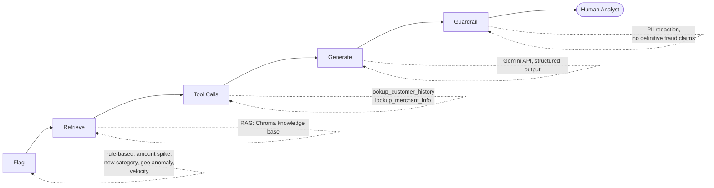

# AI Fraud-Review Copilot

An agent that takes a flagged transaction, retrieves relevant fraud-pattern knowledge, pulls customer and merchant context through tool calls, and drafts a structured case note with a recommendation — always routed to a human analyst for the final call.

[](https://github.com/shoaibhassancs/ai-fraud-review-copilot/actions/workflows/ci.yml)

## Problem

Fraud and risk teams at banks and fintechs flag transactions with rule-based triggers — unusual amount, new merchant category, geographic anomaly, velocity spikes. Every flag then lands on an analyst's desk, who manually pulls the customer's transaction history, checks the merchant's reputation, and writes a case note recommending escalation or clearance. This is slow, inconsistent in format, and doesn't scale with flag volume.

This project automates that first pass — not the decision itself, just the research and drafting an analyst would otherwise do by hand.

## Architecture



Automated end to end except the final decision — the analyst always makes the call.

| Stage | What happens | Tech |
|---|---|---|
| Flag | Rule-based flagger tags a transaction | Plain Python |
| Retrieve | Pulls the relevant fraud-pattern doc | ChromaDB (local embeddings, `all-MiniLM-L6-v2`) |
| Tool calls | Agent calls two tools for live context | Native function calling (Gemini) |
| Generate | Drafts a structured case note | Google Gemini API (`gemini-3.5-flash-lite`) |
| Guardrail | Checks output before returning | Code-level regex/rule checks |

## What it does

- Ingests synthetic transaction, customer, and merchant data
- Flags transactions on four rule-based signals: amount spike, geo anomaly, velocity spike, new merchant category
- Retrieves grounding evidence from a 4-document fraud-pattern knowledge base via RAG
- Calls two tools to pull real customer history and merchant risk context
- Drafts a structured case note (risk factors, evidence, recommendation, confidence) via an LLM
- Enforces a code-level guardrail: no definitive fraud claims, PII redacted before the response leaves the system
- Scores itself against an 18-case, hand-labeled eval set
- Runs that eval set on every push via CI, gating merges on accuracy
- Logs every request as structured JSON (latency, token cost, guardrail triggers)
- Ships as a Docker container, deployed and publicly reachable

## Tech stack

| Layer | Choice |
|---|---|
| Language | Python 3.12 |
| API | FastAPI + Uvicorn |
| LLM | Google Gemini (`gemini-3.5-flash-lite`) via `google-genai` |
| Vector store | ChromaDB (local, persistent) |
| Data | Synthetic, generated with `Faker` |
| Container | Docker |
| Hosting | Render (free tier) |
| CI/CD | GitHub Actions |

## Project structure

```
fraud-review-copilot/
├── data/
│   ├── generate_data.py      # builds the synthetic dataset
│   ├── transactions.csv
│   ├── customers.csv
│   └── merchants.csv
├── knowledge_base/
│   ├── card_not_present.md   # amount-spike evidence
│   ├── account_takeover.md   # new-category evidence
│   ├── velocity_fraud.md
│   └── geo_anomaly.md
├── src/
│   ├── schemas.py             # CaseNote model + Recommendation enum
│   ├── flagger.py             # rule-based flagging
│   ├── retrieval.py           # embeddings + Chroma lookup
│   ├── tools.py                # lookup_customer_history, lookup_merchant_info
│   ├── agent.py                # orchestration: retrieve → call tools → generate
│   ├── guardrail.py            # PII redaction + language constraints
│   └── api.py                  # FastAPI app
├── eval/
│   ├── eval_set.json           # 18 hand-labeled cases
│   └── run_eval.py             # scores the agent against eval_set.json
├── .github/workflows/ci.yml    # runs the eval subset on every push
├── Dockerfile
└── CLAUDE.md                   # full architecture + decision notes
```

## Getting started

```bash
# clone and set up your API key
git clone https://github.com/shoaibhassancs/ai-fraud-review-copilot.git
cd ai-fraud-review-copilot
cp .env.example .env
# edit .env and add your GEMINI_API_KEY

# install deps
python -m venv .venv && source .venv/bin/activate
pip install -r requirements.txt

# generate data, flag it, embed the knowledge base
python data/generate_data.py
python src/flagger.py
python src/retrieval.py

# run it
uvicorn src.api:app --reload
```

```bash
curl -X POST localhost:8000/review/T0002
```

```json
{
  "transaction_id": "T0002",
  "fraud_pattern_source": "geo_anomaly.md",
  "tools_called": ["lookup_customer_history", "lookup_merchant_info"],
  "case_note": {
    "flag_reason": "geo_anomaly",
    "risk_factors": [
      "Transaction location differs from the customer's home location",
      "Transaction amount exceeds the customer's typical maximum spend"
    ],
    "evidence": "...",
    "recommendation": "escalate",
    "confidence": 0.85
  }
}
```

## Evaluation

18 hand-labeled cases, ground truth set independently of the rule-based flagger (the flagger's job is to surface candidates, not to be correct — the eval set is allowed to disagree with it, and does on several cases).

**Original full-set result:** 61.1% (11/18) — below the 80% target.

| Flag type | Accuracy |
|---|---|
| `geo_anomaly` | 4/5 (80%) |
| `velocity_spike` | 3/4 (75%) |
| `amount_spike` | 3/5 (60%) |
| `new_merchant_category` | 1/4 (25%) |

Two confirmed reasoning bugs were found from the actual model output (not inferred from pass/fail alone) and fixed:
- The agent treated prior purchases at a merchant as mitigating an amount anomaly regardless of whether those prior amounts were actually comparable in size.
- The agent would correctly identify an account-takeover signal in its own evidence and then not let it drive the recommendation.

One case's original label was also corrected — the agent's own evidence surfaced a real customer spending pattern the original static-threshold labeling had missed.

**Post-fix:** confirmed via the 6-case CI subset at 83.3% (5/6). A full 18-case re-run has not yet been done — the figure above should be read as *improved and partially confirmed*, not re-measured in full.

## CI

Runs a fixed 6-case subset (not the full 18) on every push — sized specifically so the gate's tolerance matches the real 80% target rather than silently requiring a perfect run, after two early versions demonstrated the problem live. See `CLAUDE.md` for the full reasoning.

## Known limitations

- **Per-request latency is ~60–110s**, confirmed I/O-bound (network + model inference time), not a hosting problem — inherent to the multi-call agent design. Fine for a demo, would need addressing for production.
- **Free-tier API quota is tight** (as low as 15 requests/minute on some models) — batch operations are deliberately paced and never run against the live deployed endpoint.
- **One open question**: a previously-stable eval case failed for the first time immediately after the reasoning fix landed — not yet confirmed whether this is ordinary model variance or an unintended side effect of the fix. See `CLAUDE.md`'s "Known gaps" section.

## Out of scope

Real financial data or PII, training an actual fraud-detection model, a frontend beyond the bare API, multi-analyst auth.

## License

MIT